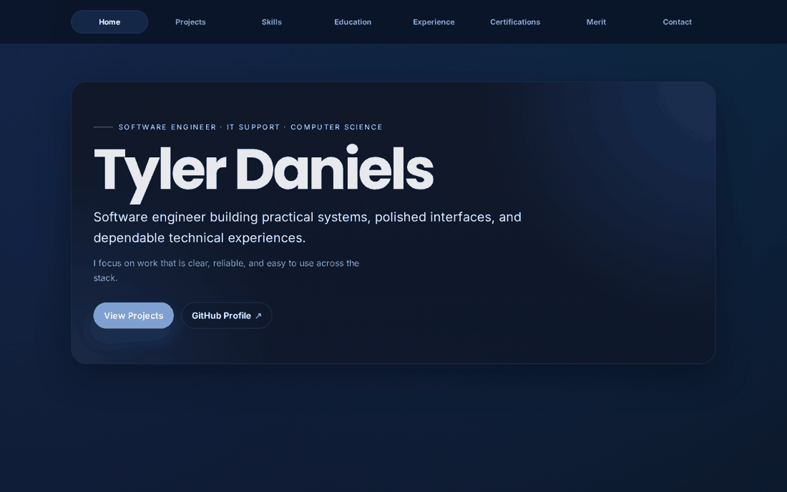
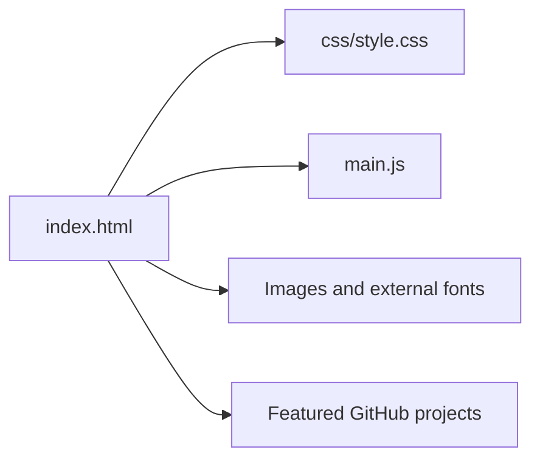

# Tyler Daniels | Software Engineering Portfolio

**A responsive personal website presenting software projects, technical experience and computer science education.**

**Live site:** [https://xtyledan.github.io/](https://xtyledan.github.io/) · [GitHub profile](https://github.com/xtyledan) · [LinkedIn](https://www.linkedin.com/in/tyler-daniels2000/)



*Actual homepage screenshot captured from the checked-in website using headless Chromium in [GitHub Actions](.github/workflows/capture-readme.yml).*

## Why this site exists

A résumé tells recruiters what someone has worked on; a portfolio gives direct access to the projects, source, documentation and examples behind those claims. This site gathers technical experience and selected work into a navigable, mobile-friendly page.

## View it

**[Open the live portfolio](https://xtyledan.github.io/)**

The site is deployed through GitHub Pages and includes:

- A project section linking to the source and screenshots of featured applications.
- Skills, education, experience and certifications.
- Responsive navigation, anchored sections and accessible interaction states.
- A separate [capstone walkthrough page](social.html).

## Run locally

Static HTML, CSS and vanilla JavaScript. No package install or build process is required for the main site.

```bash
git clone https://github.com/xtyledan/xtyledan.github.io.git
cd xtyledan.github.io
python -m http.server 8000
```

Open **http://127.0.0.1:8000/**. A static file server is preferable to opening the HTML directly when validating browser behavior and asset paths.

## Structure



| Path | Purpose |
| --- | --- |
| [index.html](index.html) | Main single-page portfolio and content |
| [main.js](main.js) | Mobile navigation, smooth scrolling, active state and reveal effects |
| [css](css) | Layout and responsive styling |
| [Images](Images) | Site imagery, including work and academic assets |
| [social.html](social.html) | Separate capstone project page |
| [.github/workflows](.github/workflows) | Deployment and genuine browser screenshot capture |

## Featured repositories

| Project | Why it matters |
| --- | --- |
| [TkForge](https://github.com/xtyledan/TkForge-Visual-Tkinter-GUI-Builder) | Visual Python/Tkinter editor with actual screenshot and automated tests |
| [Animal Rescue Explorer](https://github.com/xtyledan/Animal-Rescue-Explorer-Local-Data-Dashboard) | Filterable local data dashboard with synthetic data, HTTP API and tests |
| [C++ Brick Breaker](https://github.com/xtyledan/C-OpenGL-Brick-Breaker-CS499) | Graphics and game-logic source, with environment-specific build requirements |
| [Graduate coursework](https://github.com/xtyledan/ms-computer-science-coursework) | Technical assignments and documented academic work |

## Verification and tradeoffs

Static hosting through GitHub Pages keeps deployment simple, but this site has no backend or authentication. It references externally hosted fonts and icon stylesheets, which depend on network access. The screenshot workflow captures a real browser rendering; it does not constitute a complete accessibility or cross-device test suite.

[Deployment workflows](https://github.com/xtyledan/xtyledan.github.io/actions) show whether the latest website changes have published successfully. The screenshot is a visual example, not a guarantee that all linked third-party services remain available.

## Future improvements

- Add automated checks for broken links and keyboard-navigation regressions.
- Validate performance and accessibility across mobile browsers.
- Expand project pages with concise architecture and tradeoff summaries.

**Maintained as a personal portfolio.** No additional software license is asserted for assets or content not explicitly licensed.
